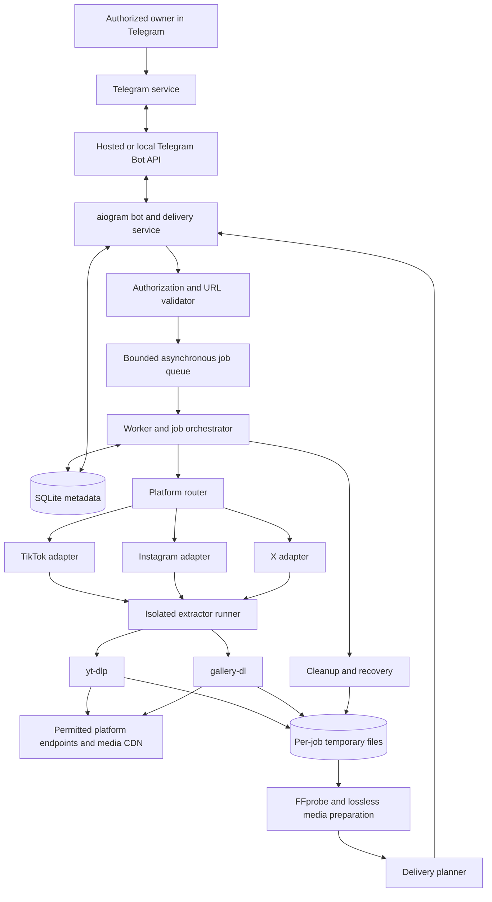
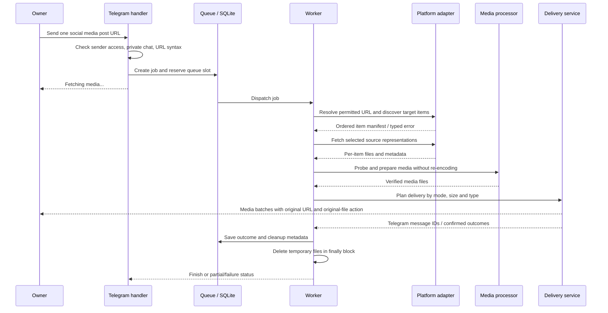
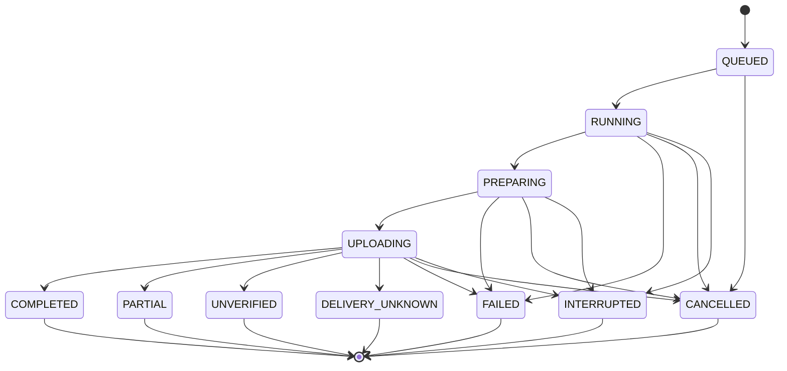
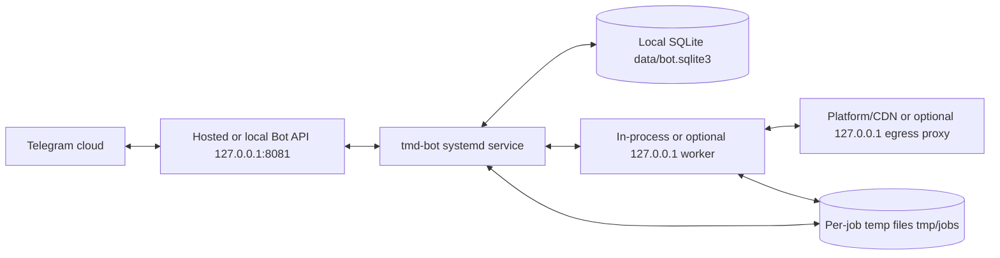

# System Architecture

# Telegram Social Media Downloader Bot

Version 1.0 | 2026-11-24 | Related: [PRD](PRD.md), [Implementation tasks](tasks.md)

## 1. Architecture decision

Use a modular Python monolith with asynchronous Telegram handling, an internal bounded job queue, isolated extractor subprocesses, temporary local files and SQLite for small operational metadata. Deploy natively (no Docker) on a single Linux VPS with `systemd`, or run directly on Windows using Python 3.12 (`uv` + `.venv`) and system FFmpeg/FFprobe. No separate frontend, Redis, Celery, PostgreSQL, AI model, object storage, or paid extraction API is required for the initial personal-use workload.

Keep extraction libraries behind adapters so a platform-specific failure can be fixed without rewriting Telegram integration. Treat every extractor result as untrusted data. Full-quality production delivery uses a local Telegram Bot API server if verified and needed for files above hosted limits. The hosted API is the lightweight development/default-small-file profile.

## 2. Technology stack

| Layer | Technology | Reason |
| --- | --- | --- |
| Language | Python 3.12+ (choose and pin a tested minor version) | Strong media tooling and async support |
| Telegram interface | aiogram 3.x | Async Bot API client, routers and callback handling |
| Video extraction | yt-dlp | Video format enumeration/download across target platforms |
| Photo / multi-item extraction | gallery-dl | Candidate extractor for image posts, albums and public Stories |
| Media inspection | FFprobe | Validate type, duration, streams, dimensions and codecs |
| Media processing | FFmpeg | Lossless stream merge/remux where possible |
| Network | httpx or aiohttp | Controlled redirect validation and adapter HTTP, with timeouts |
| Settings/contracts | Pydantic / pydantic-settings | Validated configuration and internal data contracts |
| Metadata | SQLite (WAL, restricted local `data/` directory) | Small job state, owner preferences, retries and callback mapping |
| Concurrency | asyncio.Queue + semaphores | Bounded personal-use background jobs without a broker |
| Runtime | Native Python 3.12 (`uv` + `.venv`) on Linux VPS (`systemd`) or Windows | Reproducible locked dependencies, `systemd` hardening and restart policy, no container overhead |
| Large uploads | Optional local `telegram-bot-api` server (`127.0.0.1:8081`) | Up to 2000 MB uploads per file; requires Telegram API ID/hash |
| Tests | pytest, pytest-asyncio | Unit, contract, integration and opt-in live tests |

Pin actual dependency versions in `pyproject.toml`, `uv.lock`, and `requirements.lock`; do not guess release versions. Keep tested lock files and update extractors only after smoke tests. Verify licenses for the chosen dependency distributions.

## 3. Component diagram



The extractor runner operates with restricted filesystem and network privileges. Only the bot process needs the Telegram bot token. The local API server, if enabled, is not publicly exposed.

## 4. End-to-end flow



Never claim completion before the Telegram API has confirmed the corresponding sends. Source retrieval may fail before upload, and a carousel may fail between batches. Report the confirmed outcome. A timeout during send can have unknown delivery outcome; avoid automatic duplicate sends in that case.

## 5. Suggested repository structure

```text
telegram-media-downloader/
├── PRD.md
├── architecture.md
├── tasks.md
├── README.md
├── pyproject.toml
├── uv.lock
├── requirements.lock
├── .env.example
├── .gitignore
├── start-bot.bat
├── app/
│   ├── __init__.py
│   ├── main.py
│   ├── config.py
│   ├── healthcheck.py
│   ├── bot/
│   │   ├── handlers.py
│   │   ├── callbacks.py
│   │   ├── auth.py
│   │   └── messages.py
│   ├── core/
│   │   ├── contracts.py
│   │   ├── errors.py
│   │   ├── url_validator.py
│   │   ├── net_guard.py
│   │   ├── job_queue.py
│   │   └── worker.py
│   ├── extractors/
│   │   ├── base.py
│   │   ├── router.py
│   │   ├── tiktok.py
│   │   ├── instagram.py
│   │   ├── twitter.py
│   │   ├── ytdlp_runner.py
│   │   ├── gallerydl_runner.py
│   │   ├── local.py
│   │   ├── service.py
│   │   ├── remote.py
│   │   └── session_file.py
│   ├── media/
│   │   ├── probe.py
│   │   ├── quality.py
│   │   ├── prepare.py
│   │   └── delivery_plan.py
│   ├── services/
│   │   ├── telegram_sender.py
│   │   ├── subprocess_runner.py
│   │   ├── egress_proxy.py
│   │   ├── health.py
│   │   ├── alerts.py
│   │   └── cleanup.py
│   └── storage/
│       ├── db.py
│       └── migrations/
│           └── 001_initial.sql
├── tests/
│   ├── unit/
│   ├── contract/
│   ├── integration/
│   ├── live/
│   └── fixtures/
└── ops/
    ├── setup-ubuntu.sh
    ├── deploy.md
    ├── troubleshooting.md
    ├── test-report.md
    ├── feasibility.md
    └── dev-log.md
```

Runtime directories (`data/`, `tmp/`, `secrets/`) must be excluded from Git. Test fixtures should be synthetic or explicitly licensed; never commit session cookies or personal Story media.

## 6. Platform extraction strategy

| Content | Primary candidate | Secondary candidate / decision |
| --- | --- | --- |
| TikTok video | yt-dlp | gallery-dl only if the same target video can be verified and fallback is permitted |
| TikTok photo mode | gallery-dl | Dedicated permitted photo adapter or documented API only after a successful spike; do not return an audio track or fabricate a video |
| Instagram single photo / carousel | gallery-dl | yt-dlp for verified video items only; reconcile by item identity/order, not filenames |
| Instagram Reel / video | yt-dlp | gallery-dl if it exposes the required video |
| Instagram public photo / video Story | gallery-dl | yt-dlp for exact Story video if supported; optional approved session for ordinary access |
| X photos / mixed media | gallery-dl | yt-dlp for missing verified video items |
| X video | yt-dlp | gallery-dl if it exposes the required video |

Upstream documentation lists these platforms, including Instagram Stories, but actual support depends on platform changes and access conditions. The feasibility spike is mandatory for TikTok photo mode, Instagram Stories and mixed X media. Prefer a single complete manifest per target post; use the secondary extractor only on unsupported-format or missing-media errors. Do not fallback on explicit access denial, authentication failure, rate limiting, or a challenge to avoid evading platform controls. If a source is blocked, return a typed error.

### Extraction interface

Each platform adapter implements the following conceptual interface. A library may perform discovery and download in one operation; the adapter still emits the same ordered contract and rejects unrelated media.

```python
class PlatformAdapter(Protocol):
    async def discover(self, request: ExtractionRequest) -> PostManifest: ...
    async def fetch(self, manifest: PostManifest, workspace: Path) -> ExtractionResult: ...
```

`discover` must resolve a single target post/story, determine item order and identify available formats. `fetch` must materialize only the intended items. Use opaque provider format IDs and structured extractor metadata rather than exposing signed CDN URLs to Telegram or persisting them in the database.

- Disable broad profile/playlist traversal. Some individual carousel extractors internally return playlist-like metadata; allow only entries belonging to that exact post, within the configured item limit.
- For an individual Story, verify its ID and return that Story, not every active Story of the account.
- Handle platform short URLs via validated redirects. Keep `original_url` separate from the resolved extraction URL.
- Use ordinary permitted access only. Do not implement CAPTCHA solving, proxy rotation to evade rate limits, private-content retrieval or impersonation.
- If an authorized session is used for public content, fail closed when the public nature or target item cannot be verified. Do not grant users general access to that session.
- Invoke pinned extractors in bounded subprocesses with argument arrays (`shell=False`), explicit config, isolated working directories and sanitized output. Do not let a URL act as a CLI flag. Avoid uncontrolled extractor/user config files.
- Stop subprocess groups on timeout/cancellation and enforce disk, output count and resource limits during operation.

## 7. Internal data contracts

These are proposed models, not public HTTP APIs.

```text
ExtractionRequest
  job_id: UUID
  owner_id: int
  chat_id: int
  origin_message_id: int
  original_url: str
  resolved_url: str | null
  platform: tiktok | instagram | x
  delivery_mode: media | original

PostManifest
  platform: enum
  post_id: str
  post_type: photo | video | carousel | story
  access: permitted_public | restricted | unknown
  expected_count: int | null
  items: ordered list[ItemDescriptor]

ItemDescriptor
  source_item_id: str
  position: int (zero-based)
  kind: photo | video
  candidate_formats: transient list[FormatDescriptor]

MediaAsset
  source_item_id: str
  position: int
  local_path: Path
  kind: photo | video
  mime_type: str
  size_bytes: int
  width: int | null
  height: int | null
  duration_seconds: float | null
  video_codec: str | null
  audio_codec: str | null
  sha256: str | null
  source_format: str | null
  processing: unchanged | merged | remuxed

ExtractionResult
  assets: ordered list[MediaAsset]
  expected_count: int | null
  omissions: list[ItemFailure]
  completeness: complete | partial | unverified

DeliveryOutcome
  confirmed_positions: list[int]
  telegram_message_ids: list[int]
  failed_positions: list[int]
  unknown_positions: list[int]
  completeness: complete | partial | unverified | failed
```

If manifest metadata cannot prove completeness, mark the result `unverified` even if every discovered item was sent. A full-success state requires confirmed delivery of all expected items and verified source completeness. Item order is preserved across extraction and Telegram batches; never sort by download completion time.

## 8. URL handling and network boundary

1. Accept only one URL from a message. Impose a length limit (e.g. 2048 characters), reject embedded credentials, control characters, non-HTTP(S) schemes, nonstandard ports and IP literals.
2. Parse with a real URL parser, normalize hostname, and compare against exact configured domains (not a substring check). Allow only explicitly approved TikTok, Instagram and X/Twitter hosts and item/short-link patterns. Reject profile URLs, arbitrary sites and spoofed domains.
3. Resolve short links with redirects disabled by default, manually validate every hop, cap redirect count (5), and require an allowed destination and exact post path before extraction. Convert approved HTTP URLs to HTTPS where supported, or reject insecure requests.
4. Deny loopback, private, link-local, reserved, IPv6 local and cloud metadata destinations. Validate all A/AAAA addresses and protect against DNS rebinding. Restrict extractor and FFmpeg network egress independently, including redirect/CDN requests, using a worker network policy or enforced outbound proxy; URL prevalidation alone is not enough for subprocesses.
5. Keep original user URL for captions but strip tracking parameters from the extraction URL when safe. Do not interpret captions as HTML; send plain text or escape user-controlled strings.
6. Validate extracted filesystem paths: resolved paths must remain within the assigned workspace, reject symlinks and unexpected file types, probe local files only, and disable network-capable protocols in media processing.

Default native production runs single-process (`WORKER_MODE=inprocess`) under a hardened `systemd` unit (`tmd-bot.service`: unprivileged service user, `NoNewPrivileges=true`, `PrivateTmp=true`, `ProtectSystem=strict`, `ReadWritePaths=<repo>/data <repo>/tmp`, `MemoryMax=2G`, `TasksMax=256`) with per-job workspaces, sanitized subprocess environments, POSIX rlimits, and process-tree termination. When stronger OS-level process separation is desired on a Linux VPS, run the optional pure-Python extractor worker (`python -m app.extractors.service` on `127.0.0.1:8090`) and allowlisting egress proxy (`python -m app.services.egress_proxy` on `127.0.0.1:3128`) under a separate unprivileged user that has no bot token, no SQLite access, and group-shared access only to `tmp/jobs/` (`2770`). The orchestrator remains the only trusted owner of the job database and Telegram sends.

## 9. Media quality pipeline

1. Select the highest available source representation per media item, preferring source resolution/quality metadata, then bitrate where comparable. Use actual video streams, not thumbnails or preview clips. For photos prefer the highest-resolution/full-size representation available through the permitted interface.
2. For split video/audio streams, select high-quality compatible tracks and use FFmpeg stream copy to merge. Verify with FFprobe that an audio track is retained if present at source. Preserve rotation/aspect ratio, frame rate and source streams where possible.
3. For Media mode, if the source is already Telegram-playable, send unchanged. If only container is incompatible, try lossless remux; if still incompatible, send the source as a document with an explanation. No automatic lossy transcode in v1.
4. For Original files mode, send the downloaded photo file unchanged; send the downloaded/merged video without re-encoding. Preserve existing watermarks and metadata as available. Do not remove watermarks or generate clean variants through manipulation.
5. Validate each file's actual size, type, dimensions, duration and streams. Enforce cumulative bytes during extraction to avoid exhausting disk. Keep enough free disk for temporary merge outputs.

Example local-only inspection command (conceptual):

```bash
ffprobe -v error -show_streams -show_format -of json /workspace/item.mp4
```

A stream-copy merge is allowed only if output container supports the chosen streams; use safe explicit local filenames and do not pass a user URL to FFmpeg. If merging cannot preserve streams, return a compatible lossless alternative or explain the unsupported delivery. Never assert that platform-exposed quality equals original camera quality.

## 10. Telegram delivery planning

| Item / mode | Bot API method |
| --- | --- |
| Single compatible video in Media mode | `sendVideo` (streaming flag where appropriate) |
| Single compatible photo in Media mode | `sendPhoto` |
| Photo/video album in Media mode | `sendMediaGroup` using InputMediaPhoto / InputMediaVideo |
| Original file or incompatible media | `sendDocument` |
| Group of original files | `sendMediaGroup` with InputMediaDocument only |
| Final album source link/action | `sendMessage` with inline keyboard |

Telegram allows 2-10 items per media group; document groups cannot be mixed with photo/video groups. Split a sequence into contiguous compatible runs and chunks of up to 10, preserving order. Send singletons through individual methods. For 11 photo items, send a group of 10 and one single photo, then a final source-link message. If item 3 is a document fallback between videos, deliver items 1-2, then item 3, then remaining media, in order. Keep group captions within Telegram's documented limits. For a long submitted URL that exceeds caption space, use a source-link reply below the item without truncating the URL.

Use conservative hosted thresholds (e.g. 9.5 MB native photo and 49 MB general upload; MB interpreted conservatively in decimal bytes). Local API max is 2000 MB per file (use a safe configurable lower cap, e.g. 1900 MB). Local API does not remove all photo/dimension/format constraints; validate native delivery and use documents when required. The delivery mode and service profile are independent. No automatic public file hosting or external file-sharing link fallback.

Original files buttons carry a compact opaque job ID within Telegram callback limits; verify callback owner/chat and TTL. Re-fetch permitted content on demand or use a confirmed reusable Telegram document file_id from that same bot if available. Do not assume a native photo file_id can be resent as an original document. The callback may fail if the Story is gone. A `/settings` preference allows direct original-file delivery while content is active.

## 11. Job lifecycle and persistence



All terminal states go through cleanup. Store outcome counters even for cancellation/interruption after any confirmed send. No automatic replay of an interrupted upload, since duplicate delivery is possible.

### SQLite schema (conceptual)

```sql
CREATE TABLE jobs (
    id TEXT PRIMARY KEY,
    owner_id INTEGER NOT NULL,
    chat_id INTEGER NOT NULL,
    origin_message_id INTEGER NOT NULL,
    original_url TEXT NOT NULL,
    platform TEXT NOT NULL,
    delivery_mode TEXT NOT NULL,
    state TEXT NOT NULL,
    expected_count INTEGER,
    delivered_count INTEGER NOT NULL DEFAULT 0,
    result_message_ids TEXT,
    error_code TEXT,
    parent_job_id TEXT,
    created_at TEXT NOT NULL,
    updated_at TEXT NOT NULL,
    expires_at TEXT NOT NULL,
    UNIQUE (chat_id, origin_message_id, delivery_mode)
);
CREATE INDEX idx_jobs_expiry ON jobs(expires_at);
CREATE TABLE preferences (
    owner_id INTEGER PRIMARY KEY,
    delivery_mode TEXT NOT NULL DEFAULT 'media'
);
```

Use parameterized SQL, transactions for reservation/state changes, and WAL for local concurrency. For retry/original callback jobs, reserve a fresh logical request ID using the callback query/event ID (extend the unique key with a request key in the actual migration); do not overwrite an earlier successful record. Persist callback idempotency and verified send outcomes per batch as needed in a job_deliveries table. Original URLs and preferences stay in a restricted local `data/` directory (`0700`/`0600`); purge expired jobs and dependent records after the default 24-hour TTL. Do not store actual media, signed URLs, or credentials in SQLite. Avoid long-lived backups of job URLs. SQLite is not encrypted by default; use a protected disk or encrypted filesystem if required.

On startup: migrate database, remove orphaned workspaces, mark nonterminal previous-run jobs interrupted, and report interruption on owner retry/status. Do not blindly resume uploads. If the process crashes between a Telegram send and its DB write, exact-once delivery is impossible; show an unknown outcome and let the owner decide whether to retry.

## 12. Configuration and operational limits

Example `.env.example` (values are placeholders; never use actual secrets in this file):

```dotenv
APP_ENV=development
BOT_TOKEN=replace_me
PUBLIC_ACCESS=false
ALLOWED_USER_IDS=123456789
PRIVATE_CHAT_ONLY=true
BOT_API_MODE=hosted
# Optional local mode, loopback only:
LOCAL_BOT_API_URL=http://127.0.0.1:8081
# Supply TELEGRAM_API_ID and TELEGRAM_API_HASH only to the local API service (never read by the bot).
WORKER_MODE=inprocess
WORKER_URL=http://127.0.0.1:8090
WORKER_HOST=127.0.0.1
WORKER_PORT=8090
DEFAULT_DELIVERY_MODE=media
MAX_CONCURRENT_JOBS=2
MAX_ACTIVE_JOBS_PER_USER=1
MAX_QUEUE_SIZE=10
MAX_ITEMS_PER_JOB=30
EXTRACTION_TIMEOUT_SECONDS=120
UPLOAD_TIMEOUT_SECONDS=600
MAX_TEMP_BYTES_PER_JOB=4000000000
HOSTED_PHOTO_MAX_BYTES=9500000
HOSTED_FILE_MAX_BYTES=49000000
LOCAL_FILE_MAX_BYTES=1900000000
JOB_METADATA_TTL_HOURS=24
ORPHAN_TTL_MINUTES=30
LOG_LEVEL=INFO
```

Production startup (`APP_ENV=production`) supports single-process `WORKER_MODE=inprocess` and requires a valid token, `PRIVATE_CHAT_ONLY=true`, and either `PUBLIC_ACCESS=true` or a nonempty list of numeric Telegram IDs (`ALLOWED_USER_IDS`). When `WORKER_MODE=remote` is enabled in production, startup additionally enforces a strong `WORKER_SECRET` (>= 24 chars) and valid `WORKER_URL`. Operational alerts, when enabled, go to `ALLOWED_USER_IDS`. Optional file-based secrets (`BOT_TOKEN_FILE`, `WORKER_SECRET_FILE`, `INSTAGRAM_COOKIES_FILE`) live under `secrets/` with restrictive permissions (`0400`/`0440`) and are never logged or sent to Telegram. The optional local Bot API server obtains its own API ID/hash separately; consult official migration instructions, including `logOut` from hosted API before switching and preventing concurrent polling from both endpoints.

Retries: at most two for safe transient network/extraction errors, exponential backoff with jitter, respecting `Retry-After`; no retry for invalid/restricted/expired content or known permanent errors. Telegram 429 retry only after specified delay; unknown send timeout requires user-visible uncertainty, not blind replay. Status edits are throttled to avoid chat spam and rate limits.

## 13. Deployment design

### Development & desktop profile (Windows / Linux / macOS)

- Runs natively with Python 3.12 (`uv` + `.venv`) and `ffmpeg`/`ffprobe` on `PATH` — no Docker required.
- On Windows, launch via `start-bot.bat` or `uv run python -m app.main`.
- One bot process using long polling (no public webhook/domain needed), hosted Telegram Bot API, locked dependencies, local SQLite (`data/bot.sqlite3`), and per-job temp directory (`tmp/jobs/`).
- Restrict to test owner. Validate content using permitted live links and mocked fixtures.

### Production profile (Linux VPS, native `systemd`)



In the default hosted single-process deployment (`ops/setup-ubuntu.sh`), `tmd-bot.service` calls Telegram cloud directly and runs extractors in-process (`WORKER_MODE=inprocess`) under `APP_ENV=production` with `systemd` hardening (`NoNewPrivileges`, `PrivateTmp`, `ProtectSystem=strict`, `ReadWritePaths`, `MemoryMax=2G`, `TasksMax=256`).

Starting VPS sizing assumption: 2 vCPU, 4 GB RAM, 40 GB SSD, adequate bandwidth; smaller VPS may work for light hosted-mode jobs. Measure CPU, memory, upload bandwidth and temp disk usage with the real workload. Local API operation and 2 GB files may require more storage/RAM; include its own temporary/cache directory in capacity planning. Protect `data/`, `tmp/jobs/`, `.env`, and `secrets/` with explicit service-user ownership. Only expose SSH (via UFW); bind any local Bot API, remote worker, or egress proxy strictly to `127.0.0.1`. Use an unprivileged service user (`tmd` or `SUDO_USER`), `systemd` restart policy, `python -m app.healthcheck`, `journald` log caps, `uv.lock`/`requirements.lock` dependency pinning, and resource limits.

If running an optional local Bot API server on `127.0.0.1:8081`, keep it restricted to the dedicated service user and multipart uploads (or an explicitly scoped transfer directory); never expose arbitrary filesystem paths. Keep both modes covered by integration tests.

### Operations and observability

- Log request/job ID, platform, state, duration, file size, counts, retry count and normalized error code. Redact URLs, credentials, signed media addresses and subprocess output.
- Health check (`python -m app.healthcheck`): reads `data/heartbeat` (no network) to verify polling freshness, worker connectivity, SQLite writability and disk headroom. Alert on repeated failures or disk pressure if desired (`ALERTS_ENABLED=true`); no public dashboard needed.
- Record extractor versions and platform-specific live smoke results. Review updates after platform breakages and roll back to the last tested Git commit + `uv sync --locked --no-dev` if needed.
- Cleanup in `finally` plus scheduled orphan checks (in-process while running) and startup sweep; never remove an active job directory. On service shutdown (`systemctl stop`/`restart` or `Ctrl+C`), cancel safely and mark interrupted jobs.
- Include cache/temporary directory cleanup for the local Bot API according to its documented behavior. Removing local files does not delete Telegram chat messages or necessarily Telegram's retained copy.

## 14. Error contract

| Error code | Retry? | Meaning |
| --- | --- | --- |
| UNAUTHORIZED | No | Owner/chat check failed |
| INVALID_URL | No | Unsupported or unsafe URL |
| UNSUPPORTED_POST | No | Outside the supported item types |
| NOT_FOUND_OR_EXPIRED | No | Source unavailable or Story expired |
| ACCESS_RESTRICTED | No | Private, protected, paywalled or unknown access |
| AUTH_REQUIRED | No until configured | Permitted normal session required for public source |
| RATE_LIMITED | Respect server | Platform or Telegram rate limit |
| EXTRACTOR_CHANGED | Manual/limited | Provider no longer returns expected schema/media |
| DOWNLOAD_TIMEOUT | Limited | Bounded extraction timed out |
| LIMIT_EXCEEDED | No | Item/size/storage budget exceeded |
| FILE_TOO_LARGE | No | Upload limit exceeded with no safe path |
| MEDIA_INVALID | No | Invalid type, stream or damaged file |
| UPLOAD_FAILED | Only if safe | Definite Telegram rejection or transient safe failure |
| DELIVERY_UNKNOWN | Owner decides | Delivery may have succeeded before timeout |
| CANCELLED | No | User cancelled |
| INTERRUPTED | Owner decides | Process restarted mid-job |

## 15. Tests and security gates

- Unit-test URL allowlist, short-link paths, original URL preservation, callback ownership, size thresholds, album chunking and typed error mapping.
- Contract-test normalized manifest and ordering from sanitized fixtures for every platform/content type.
- Integration-test a simulated Telegram server, worker boundaries, DB transitions, partial/unknown uploads, cleanup and process restarts.
- Verify network isolation against loopback/private-IP redirects, DNS rebinding, malicious output paths, unsupported domains and attempts to read credentials. Test without contacting real internal services.
- Run live tests only on owner-authorized/public permission-cleared posts, respecting platform rate limits. Active Stories require fresh fixtures; do not preserve private content.
- Complete Android/iOS visual checks of playable media, source captions, album ordering and original documents.

## 16. Primary references

- Bot API: https://core.telegram.org/bots/api
- Official local Bot API server: https://github.com/tdlib/telegram-bot-api
- aiogram documentation: https://docs.aiogram.dev/
- yt-dlp project: https://github.com/yt-dlp/yt-dlp
- yt-dlp supported sites: https://github.com/yt-dlp/yt-dlp/blob/master/supportedsites.md
- gallery-dl project: https://github.com/mikf/gallery-dl
- gallery-dl supported sites: https://github.com/mikf/gallery-dl/blob/master/docs/supportedsites.md
- FFmpeg / FFprobe documentation: https://ffmpeg.org/documentation.html

Platform coverage and Telegram size/album limits were checked against upstream documentation on 2026-11-24. The proposed architecture is not a claim that any integration has already been built or tested.
